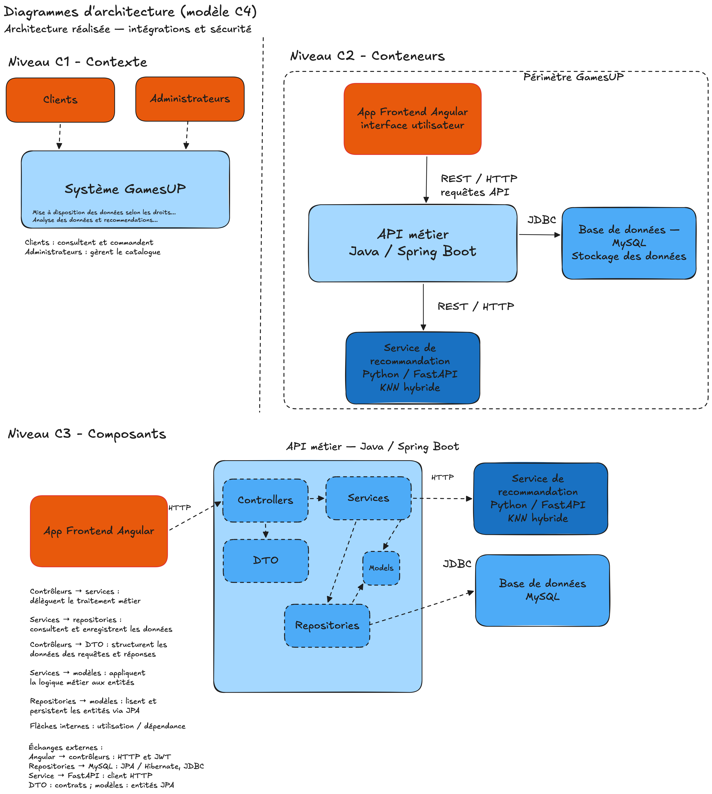
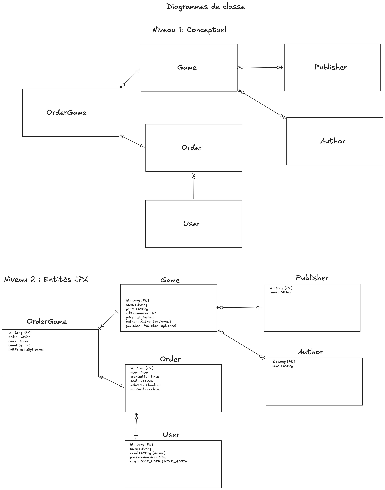
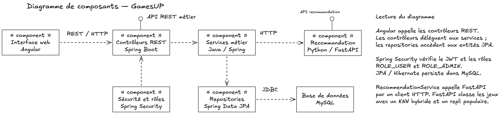
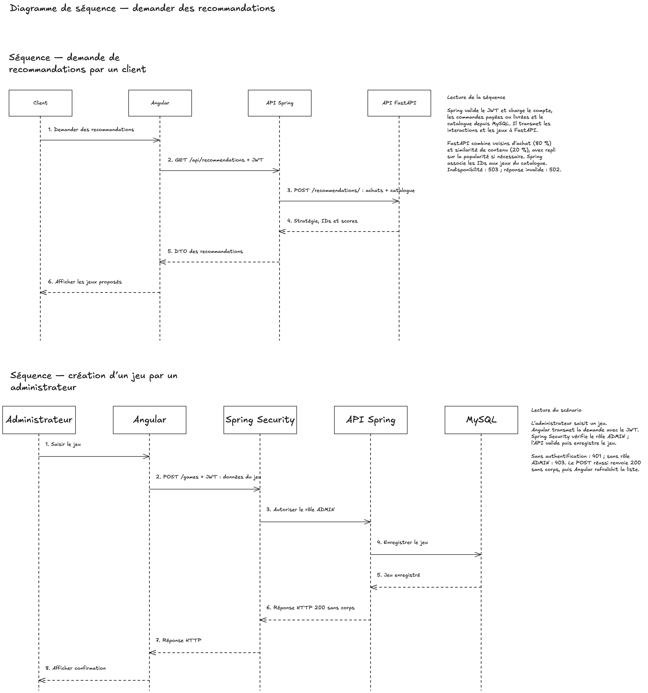
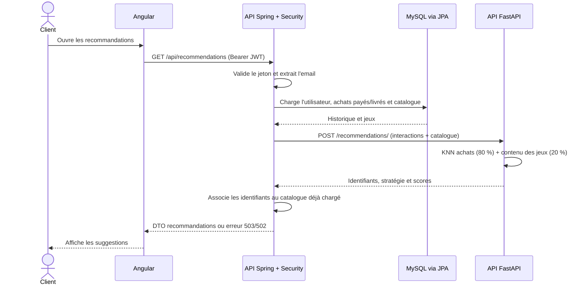

# Architecture et diagrammes

## Contexte et exigences de qualité

GamesUP s'appuie sur un client Angular, une API métier Spring Boot, une API de recommandation FastAPI et une base MySQL. L'API Python reçoit seulement les données nécessaires au calcul. Cette séparation permet de faire évoluer l'algorithme sans déplacer les règles de commande ni l'authentification.

Les décisions visent une séparation des responsabilités, des contrats REST explicites, une protection par JWT stateless et une persistance relationnelle gérée par Hibernate/JPA.

## Diagramme d'architecture (C4)

Le dessin représente les trois applications et MySQL. Angular appelle Spring en HTTP ; Spring interroge MySQL par JPA/Hibernate et appelle FastAPI par HTTP pour les recommandations. FastAPI ne possède pas de base persistante et est appelé par Spring.

## Diagramme de classes

Le modèle relationnel associe utilisateurs et commandes, commandes et lignes d'achat, puis chaque ligne à un jeu. Un jeu peut référencer un auteur et un éditeur. `OrderGame` porte les attributs de l'association commande-jeu, notamment la quantité et le prix unitaire observé à l'achat. Le dessin représente le noyau des entités métier ; les DTO décrivent les contrats d’échange.

## Diagramme de composants

Dans Spring, les contrôleurs exposent les routes et délèguent aux services. Les services orchestrent les règles métier et les repositories JPA. Le client HTTP de recommandation est appelé par le `RecommendationService`. Les DTO constituent les contrats des contrôleurs et de l'intégration Python ; les entités JPA ne sont pas renvoyées directement par l'API.

## Diagramme de séquence

La séquence de recommandation décrit le parcours réalisé : la page Angular `/recommendations` demande les recommandations à Spring avec son jeton, Spring charge les achats finalisés et le catalogue, transmet ces données à FastAPI, puis reconstruit la réponse à partir des jeux présents dans sa propre base. La séquence d'administration correspond au contrôle de rôle fait par Spring avant l'exécution des opérations protégées.

### Séquence actuelle de recommandation

## Composants et échanges

| Composant | Responsabilité | Échanges |
| --- | --- | --- |
| Angular | Interface client et administration, formulaires et navigation protégée côté interface | HTTP vers Spring, jeton Bearer en mémoire |
| Spring Boot | Authentification, rôles, validation, règles de gestion, REST et orchestration des recommandations | JPA/MySQL et HTTP/FastAPI |
| MySQL | Persistance des comptes, rôles, jeux, auteurs, éditeurs et commandes | JDBC piloté par Hibernate |
| FastAPI | Validation du contrat et classement KNN hybride | Appelé par Spring ; ne persiste pas les données |

## Limites et évolutions

La [source Excalidraw](diagrammes/diagrammes-gamesup.excalidraw) permet de modifier et de réexporter les diagrammes. Pour les gros volumes, il faudra éviter de transmettre tout le catalogue et tous les achats à chaque requête et séparer le calcul de l'entraînement/rafraîchissement d'un index.
